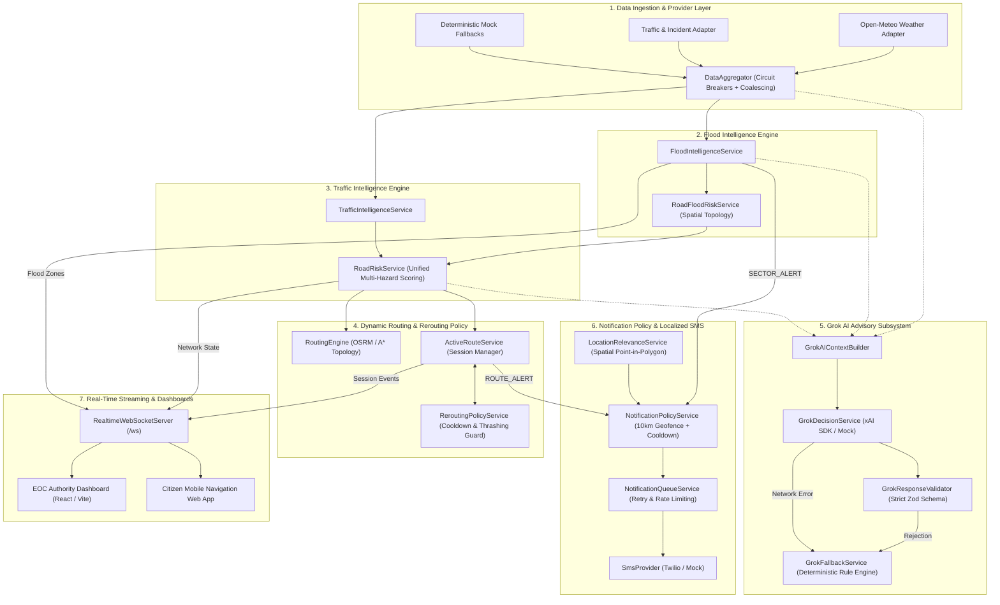

# Smart City Guardian: System Integration Map (Phase 8)

## 1. Executive Architecture Overview

Smart City Guardian is an autonomous, multi-hazard urban mobility and citizen protection platform. It unites seven specialized subsystems into a resilient, decoupled event-driven architecture designed to withstand severe weather emergencies, power/telecom degradations, and upstream AI outages.



---

## 2. Subsystem Inventory & Responsibilities

| Subsystem | Core Module / Services | Authority Status | Data Store | Key Inputs | Key Outputs |
| :--- | :--- | :--- | :--- | :--- | :--- |
| **1. Data Ingestion** | `dataAggregator.ts`, `openMeteoAdapter.ts`, `tomTomTrafficAdapter.ts`, `circuitBreaker.ts` | Authoritative for external sensor ingest | `LiveStateStore` (In-memory, TTL cached, coalesced) | Upstream HTTP REST, Open-Meteo, TomTom, GeoJSON files | Normalized `WeatherObservation`, `TrafficSegmentTelemetry`, `TrafficIncident` |
| **2. Flood Intelligence** | `floodIntelligence.service.ts`, `roadFloodRisk.service.ts` | **Authoritative** for flood risk indices and water depths | `LiveStateStore` (`flood_evaluation_latest`) | Weather telemetry, municipal drainage topology, elevation grids | `FloodRiskEvaluation`, `SectorFloodState`, `AffectedRoad` |
| **3. Traffic & Multi-Hazard** | `trafficIntelligence.service.ts`, `roadRisk.service.ts` | **Authoritative** for road accessibility and mobility risk | `currentRiskMap` (In-memory Map<roadId, RoadRiskRecord>) | Ingested traffic feeds, active incidents, flood road risks | Unified `RoadRiskRecord` (`OPEN`, `CAUTION`, `HIGH_RISK`, `BLOCKED`) |
| **4. Dynamic Routing** | `routingEngine.service.ts`, `activeRoute.service.ts`, `reroutingPolicy.service.ts` | **Authoritative** for route geometry, travel times, and session states | Active sessions map, Route version histories | Origin/destination coords, live `RoadRiskRecord[]`, GPS breadcrumbs | `CandidateRouteOutput`, `ActiveRouteSession`, `ROUTE_RECALCULATED` events |
| **5. Grok AI Advisory** | `GrokDecisionService.ts`, `GrokAIContextBuilder.ts`, `GrokResponseValidator.ts`, `GrokFallbackService.ts` | **Advisory Only** (Never authoritative; cannot override backend safety rules) | LRU circular cache (max 500 decisions) | Canonical contextual payload (`CanonicalAIContext`) | `StoredAiDecision` (`GrokDecisionOutput` with structured actions) |
| **6. Notification Subsystem** | `notificationPolicy.service.ts`, `notificationQueue.service.ts`, `locationRelevance.service.ts`, `userPreference.service.ts` | **Authoritative** for citizen SMS dispatch, eligibility, and spam prevention | In-memory queues, user preferences map, delivery history | Domain events (`ROUTE_ALERT`, `SECTOR_ALERT`), user geofences | Masked SMS alerts, in-app push messages, delivery receipts |
| **7. Real-Time Streaming** | `wsServer.ts`, WebSocket client handlers | Authoritative for real-time state distribution | Connected WebSocket client table, subscription topic trees | System domain events, periodic heartbeat (10s), direct client actions | JSON WebSocket frames (`CONNECT_ACK`, `TELEMETRY_UPDATE`, `ROUTE_RECALCULATED`) |

---

## 3. Authoritative vs. Advisory Boundaries

```
+-----------------------------------------------------------------------------+
|                          BACKEND AUTHORITATIVE DOMAIN                       |
|                                                                             |
|  [Hydrological Engine]    [Mobility & Graph Router]    [Policy & Security]  |
|  - Water depth in cm      - Physical road impassability- Geofence filtering |
|  - Zone severity score    - Geometric detour paths     - SMS frequency caps |
|  - Inundation contours    - Session ownership check    - Phone number mask  |
+-----------------------------------------------------------------------------+
                                       |
                   Feeds Canonical Data via Strict Context
                                       v
+-----------------------------------------------------------------------------+
|                            GROK AI ADVISORY LAYER                           |
|                                                                             |
|  - Natural language synthesis in EN, ES, HI, TA, FR                         |
|  - Strategic emergency coordinator insights & citizen guidance notes        |
|  - STRICT BOUNDARY: Cannot unblock closed roads or declare safe conditions  |
|  - VALIDATION: Every claim verified against backend ground truth            |
|  - RESILIENCE: Automatic instantaneous fallback on API latency or errors    |
+-----------------------------------------------------------------------------+
```

---

## 4. End-to-End Data Flow Contracts

### 4.1 Weather to Flood Risk
- **Trigger**: Data ingestion interval (30s) or manual operator trigger.
- **Payload Contract**: `WeatherObservation` (`rainfallRateMmh`, `precipitation.past1HourMm`).
- **Processing**: Weighted runoff model evaluates drainage absorption and soil saturation index.
- **Output**: `FloodRiskEvaluation` with affected zone polygons and water depth estimates.

### 4.2 Flood & Traffic to Unified Road Risk
- **Trigger**: `FLOOD_ZONE_UPDATED` or `TRAFFIC_INCIDENT_INGESTED`.
- **Processing**: `RoadRiskService.evaluateAllRoadRisks()` executes atomic coalesced evaluation.
- **Formula**:
  $$\text{Composite Risk} = 0.55 \times \text{Flood} + 0.30 \times \text{Traffic} + 0.15 \times \text{Incident}$$
  - Physical submergence ($> 20\text{ cm}$) or closure incident immediately sets $\text{Risk} = 100$, state $=$ `BLOCKED`.
- **Output**: Broadcasted `ROAD_RISK_UPDATED` event and updated in-memory routing weights.

### 4.3 Road Risk to Active Commuter Rerouting
- **Trigger**: `ROAD_RISK_UPDATED` received by `ActiveRouteService`.
- **Processing**: Matches active session segments against deteriorated roads. If road is blocked, bypasses cooldown timer immediately; if congestion increases by $\ge 25\%$, checks 90-second cooldown timer.
- **Output**: Calculates detour avoiding blocked corridor, updates active session version, and emits `ROUTE_RECALCULATED` to WebSocket user topic `user:${userId}`.

### 4.4 Rerouting to Localized Notification
- **Trigger**: `ROUTE_RECALCULATED` event.
- **Processing**: `NotificationPolicyService` evaluates commuter coordinates, language preference, minimum severity threshold, and quiet hours.
- **Formatting**: `@smartcity/shared` `formatLocalizedAlert` generates concise bilingual SMS (under 160 GSM chars).
- **Output**: Enqueued to `NotificationQueueService` for rate-limited dispatch via Twilio / Mock provider.

---

## 5. Security & Isolation Boundaries

1. **User Object-Level Authorization**:
   - Navigation sessions (`/api/v1/routes/:id/stop`, `/api/v1/routes/:id/sync`) enforce strict matching between `userId` in authentication context and session owner. Unauthorized modification yields `HTTP 403 Forbidden`.
   - Saved location operations (`DELETE /api/v1/location/saved/:id`) verify record ownership before deletion.
2. **Citizen Privacy & Masking**:
   - Phone numbers are stored securely and always masked in outbound logs, audit histories, and API responses (`+91 98*** ***10`).
   - Commuter GPS breadcrumbs are held ephemerally in active memory sessions and are permanently purged upon session conclusion.
3. **Prompt Injection & AI Sanitization**:
   - All dynamic input fields fed to Grok prompts (road names, incident notes, zone descriptions) are sanitized against instruction-override delimiters (`SYSTEM:`, `IGNORE PREVIOUS`, `###`).
